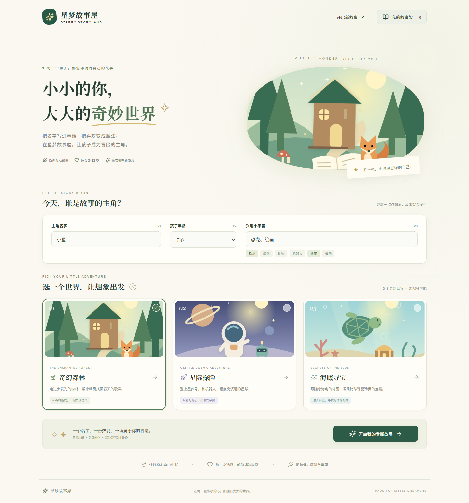
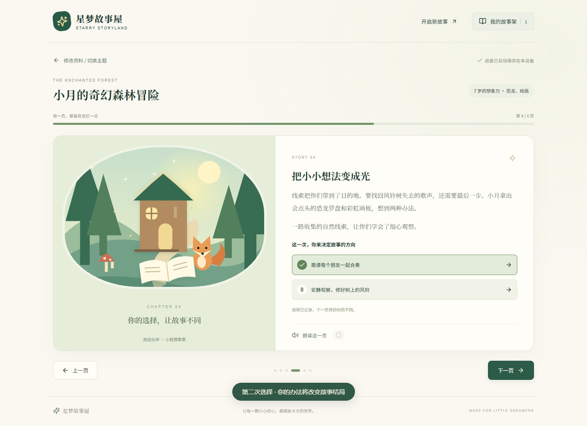
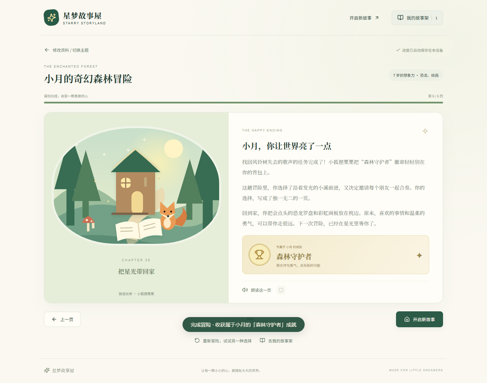
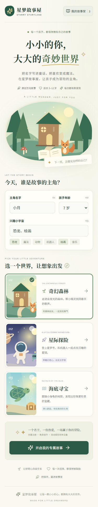
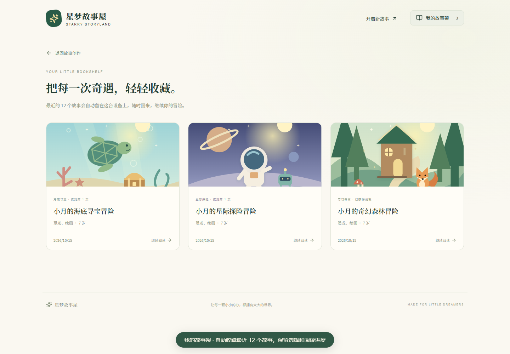

# 星梦故事屋 · Starry Storyland

> 把名字写进童话，把喜欢变成魔法。

一个可直接运行、无需 API Key 的个性化儿童互动故事 Web 应用。输入主角名字、3～12 岁年龄、兴趣与主题，在六页原创故事里做出两次选择，收获自己的成就徽章。

本项目使用本地规则与剧情组合生成故事，不会调用大模型或上传孩子的资料。所有插图均为项目内原创 SVG，没有素材版权或外部图片服务依赖。

## 交付导航

- [演示视频 MP4，117 秒](docs/demo.mp4) / [原始 WebM](docs/demo.webm)
- [验收与评分自检报告](docs/ACCEPTANCE.md)
- [发布步骤](docs/PUBLISH.md)
- GitHub 仓库：当前环境未获得 GitHub 授权，尚未创建，不能提供虚构链接。
- 在线站点入口：[星梦故事屋](https://starry-storyland-z-20261015.nicemochi13.chatgpt.site)（Sites 所有者私有，需对应账号登录；不作为教师可匿名访问的公开演示地址）。部署状态以实际访问和最终交付回复为准。本地项目不依赖在线版本即可完整运行。

## 界面预览





<details><summary>查看手机端与故事架</summary>





</details>

## 功能亮点

- **真正个性化**：名字融入对话；3～5、6～8、9～12 岁采用不同词汇、句长与思考方式；兴趣改变工具和行动，支持多种预设兴趣与自由输入。
- **三个原创世界**：森林友情、宇宙探索、海洋环保，各有独立的任务、伙伴、线索与结局。
- **两次真实选择**：第 2、4 页必须先选择；改变路线会改变第 3 页，改变方案会改变第 5 页与结尾回顾。回退修改第一次选择会清空后续选择，保持剧情一致。
- **完整六页结构**：邀请 → 选择路线 → 发现线索 → 决定方案 → 实践解决 → 结局与成就。
- **浏览器语音**：朗读、暂停、继续、停止；翻页或离开阅读时自动停止，不支持或播放失败时降级为文字阅读。
- **自动保存**：有效资料、最近 12 个故事、阅读页、分支选择保存在 localStorage；刷新后恢复当前故事。
- **响应式体验**：1440px 桌面与 375px 手机布局，键盘焦点、表单错误提示、加载反馈、空状态、存储异常提示和减少动画偏好支持。

## 技术栈与环境

React 19 · TypeScript 5.9 · Vite 7 · 模块化页面/组件与 CSS · Lucide React · Vitest 5 · Playwright。

- 推荐 **Node.js 24 LTS**（本机实测 v24.16.0）、npm 11。
- 安装依赖时需要网络；安装完成后主要功能完全在本地运行。
- 浏览器推荐新版 Chrome / Edge / Firefox / Safari。自动测试使用 Chromium。
- 浏览器语音依赖系统的中文语音支持，部分语音服务可能需要网络。
- 不需要后端、数据库、注册账号或环境变量。

## 安装与启动

在项目根目录打开终端：

```bash
npm install
npm run dev
```

打开终端打印的本地地址，通常是 `http://127.0.0.1:5173`。若端口被占用，Vite 会提示实际地址。请使用 HTTP 服务访问，不要直接双击 `index.html`。

已有锁文件时，自动化或干净环境建议使用 `npm ci`。

## 构建与预览

```bash
npm run typecheck
npm run build
npm run preview
```

产物在 `dist/`。Vite 使用相对资源路径，可托管在 GitHub Pages 的项目子路径。`preview` 通常使用 `http://127.0.0.1:4173`。

## 测试

```bash
npm test
npx playwright install chromium
npm run test:e2e
```

端到端测试会自动启动开发服务器（已有 5173 服务时复用）。Linux CI 可用 `npx playwright install --with-deps chromium` 安装系统依赖。

Windows 已安装 Edge 时也可以使用：

```powershell
$env:PLAYWRIGHT_CHANNEL='msedge'
npm run test:e2e
```

测试内容及最终实测记录见 [验收报告](docs/ACCEPTANCE.md)。语音控制流程由可控的浏览器语音替身验证；这不代表所有系统上都能实际播放中文音频。

## 三个故事世界

| 主题     | 伙伴与任务                   | 互动路线                                   | 成就       |
| -------- | ---------------------------- | ------------------------------------------ | ---------- |
| 奇幻森林 | 小狐狸栗栗；找回风铃树的歌声 | 小溪 / 蘑菇小径；合奏 / 修风铃             | 森林守护者 |
| 星际探险 | 机器人点点；重新点亮星球灯塔 | 晶石谷 / 邮递员；阳光收集器 / 能量线路     | 星光领航员 |
| 海底寻宝 | 小海龟泡泡；恢复珊瑚花园生机 | 水母隧道 / 海马图书馆；清理海湾 / 种子花园 | 海洋小卫士 |

## 操作说明

1. 修改默认资料“小星 / 7 岁 / 恐龙、绘画”。兴趣快捷按钮会替换当前输入；也可直接输入多个兴趣。
2. 点击任一主题卡，再点击“开启我的专属故事”。
3. 使用上一页、下一页阅读；遇到选项先做选择，才能前进。
4. 点击“朗读这一页”开始朗读，再点可暂停或继续，方形按钮停止。
5. 第 6 页展示成就，既能开启新故事，也能重新冒险并尝试其他路线。
6. 顶部“我的故事架”打开历史；点击故事卡恢复上次页码与选择。
7. “修改资料 / 切换主题”回到创作页，原故事保留在故事架；创建新故事后最多保留最近 12 个。

资料和历史仅属于当前浏览器与站点来源（协议、域名、端口）。换浏览器、换设备、清理站点数据后不会自动同步。生成与阅读有效状态会即时保存，无效表单不会覆盖已保存的有效资料。

## 项目结构

```text
personalized-kids-storybook/
├─ src/
│  ├─ components/        Header、原创 Illustration
│  ├─ pages/             HomePage、ReaderPage、LibraryPage
│  ├─ data/themes.ts     三主题剧情、路线、方案与成就数据
│  ├─ engine/            故事生成、个性化、分支状态与单元测试
│  ├─ hooks/             故事库持久化、语音生命周期
│  ├─ types/             Profile、Story、Scene、Theme 类型
│  ├─ utils/             数据校验、存储恢复与测试
│  ├─ App.tsx            页面协调
│  └─ styles.css         视觉系统、响应式和动画
├─ tests/app.spec.ts     浏览器交互测试
├─ scripts/record-demo.mjs  自动录制与截图
├─ docs/                 截图、视频、验收报告与发布说明
├─ .github/workflows/pages.yml  测试、构建、Pages 部署
├─ .openai/hosting.json  Sites 静态托管配置
├─ playwright.config.ts
└─ vite.config.ts
```

## 核心实现

`Story` 保存生成时的资料快照、开场 seed、两次选择和当前页码。正文由纯函数 `getScenes(story)` 根据快照推导，无需保存重复文本。固定 seed 和选择可以重现相同故事；三个开场变体、每主题四条分支组合以及个性化参数共同形成不同体验。

`choose` 在更改第一个选择时删除后续选择。`canAdvance` 统一处理分支页前进条件。`interestKit` 将兴趣映射到工具与具体行动；未预设的兴趣通过灵感手册与观察实践融入剧情。主题剧情由数据表提供，扩展第四个主题时需要添加 ThemeId、主题数据、插图及视觉映射。

读取 localStorage 时验证类型、年龄范围、页码、时间和分支完整性，过滤损坏条目。存储被禁用或配额不足不会阻止阅读。React 以文本方式渲染用户输入，不使用 `dangerouslySetInnerHTML`。

SVG 图形与图标随包交付，页面无外部字体或图片请求。UI 采用系统中文字体回退，离线也能展示。所有动画尊重 `prefers-reduced-motion`。

## 演示录像与复现

先启动开发服务器，再在另一个终端执行：

```bash
npx playwright install chromium
npm run demo
```

脚本会录制实际浏览器操作、添加说明字幕、保存桌面与手机截图，生成 `docs/demo.webm`；若 PATH 中存在 FFmpeg，则自动转换为 `docs/demo.mp4`。已有浏览器可使用 `PLAYWRIGHT_CHANNEL=msedge` 或 `chromium`。也可通过环境变量 `DEMO_URL` 指向自己的测试地址。

视频展示欢迎页、个性化输入、两次分支、成就、其他主题、历史、刷新恢复与手机效果。录像不采集系统音频；语音按钮可操作与实际发声是两项不同能力。

## 已知限制

- 当前是本地规则与模板组合引擎，内容数量有限，重复输入可能出现相同情节；不是在线大模型生成。
- 自由兴趣可融入情节，但不像六类预设兴趣那样有完整的专用工具设计。
- 系统没有中文语音、语音服务不可用或浏览器禁用语音时，只能使用文字阅读。
- localStorage 不跨设备同步；仅保留 12 个最近访问/创建的故事，不提供账号云存储。
- 当前环境未获得 GitHub 授权；本地 Git 和发布配置已准备，远程仓库需按发布文档完成授权后创建。
- 自动化验收覆盖 Chromium / Edge，尚未声称经过真实 iPhone、Safari 或 Firefox 全量实机验收。

作业由 AI 辅助完成。提交前请依课程规范说明使用方式，并理解故事引擎、状态管理和测试代码。
