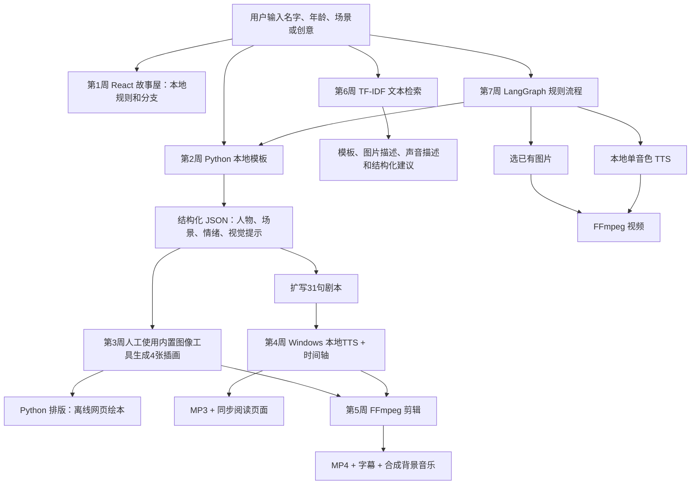

# 实际系统架构与数据流

图中第 1 周独立运行；第 3 周图片并非通过项目代码自动调用 API 生成；第 6 周检索主要是独立功能，第 7 周选择图片是规则匹配素材，并非调用第 6 周检索接口。第 4 周故事由第 2 周故事**扩写**，而非直接逐字朗读 JSON 的四段文本。

## 关键工程决策

1. **成本与离线**：故事使用本地模板，语音调用系统声音；运行时不依赖 API。代价是创意范围、表达和部署环境受限。
2. **角色一致性**：第 3 周首张插画作为后续生成的参考，并重复外貌描述；不是 LoRA 或 CLIP 身份锁定，细节仍有偏差。
3. **视频时间轴**：第 4/5 周按逐句 WAV 片段时长做字幕；第 7 周视频按字数分配场景时长，仅为粗略估算。
4. **数据校验和错误处理**：第 2 周验证必需字段和场景编号；第 6 周检查输入；第 7 周输出路径不覆盖现有目录，失败写错误记录。没有实现 API 重试或云端缓存。
5. **检索与工作流边界**：检索使用中文字符 TF-IDF 匹配人工描述，没有 CLIP；LangGraph 使用固定有向图和规则选主题，不能称为大模型自主规划。
